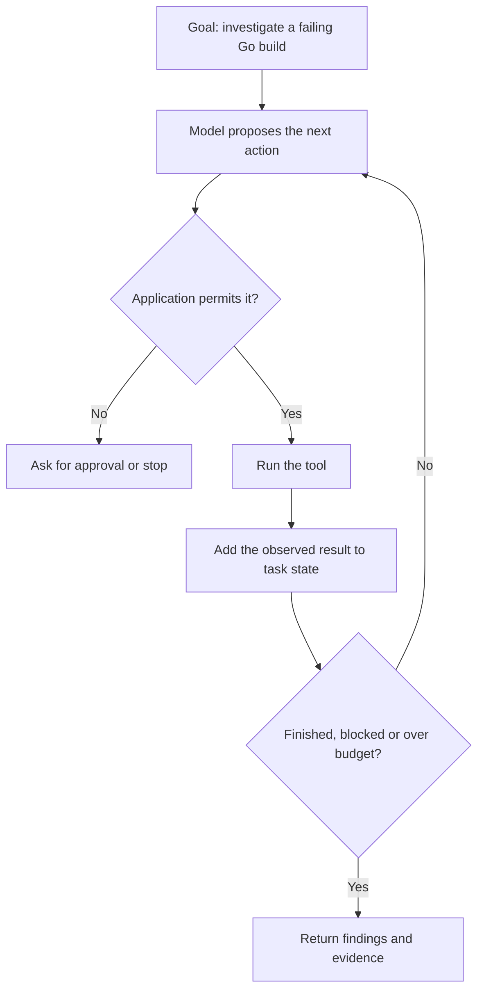
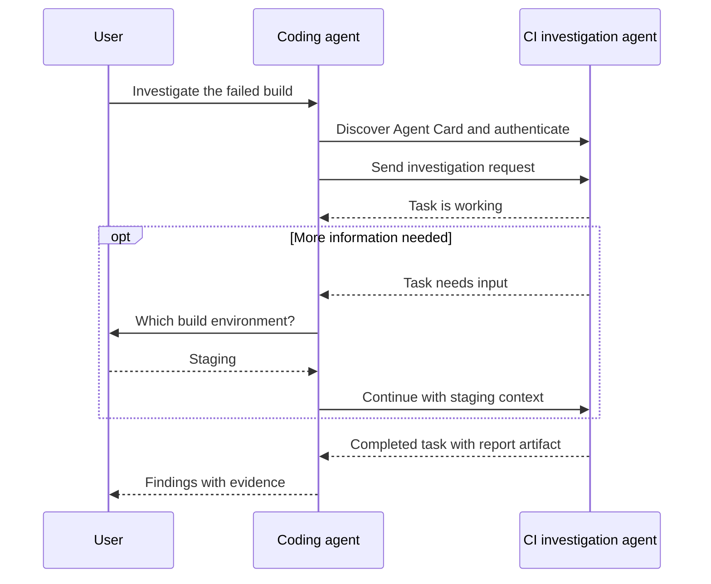
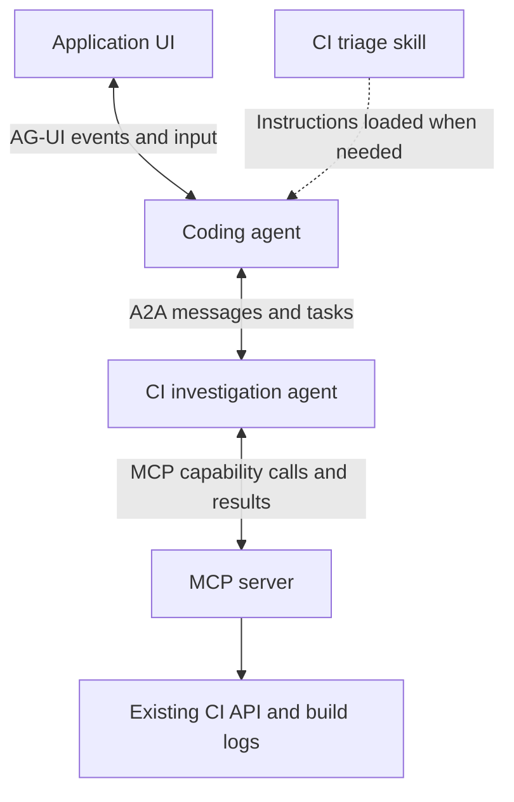

An assistant that explains a failing test and an assistant that investigates the failure are doing different jobs. The first can answer from the information in a prompt. The second needs to inspect files, run a test, read the result and decide what to try next.

That second case is where agents become useful. But the vocabulary around them gets confusing quickly. An agent, a skill and an MCP server can all appear in the same application without being the same thing.

I find it easier to follow one example: a coding assistant investigating a failing Go build. We can add each piece when the problem needs it.

If the model terminology is unfamiliar, [Generative AI: how it works and when to use it]() explains the model underneath the application.

## What is an AI agent?

In this article, an *AI agent* means an application that uses a language model to choose actions toward a goal, observes what happens and decides what to do next. This is the current LLM-based use of the term; agents are a broader idea in AI.

The application provides the tools, state and permission checks. The model helps choose the next action. The agent might inspect a file, run a command, ask a person for clarification or stop with an answer. It does not need a separate model trained specifically for that job.

Anthropic's *Building effective agents* makes a useful distinction: a workflow follows predefined code paths, while an agent lets the model direct the process and tool use.[^agents]

Compare these approaches:

| Approach | Investigating a Go build |
| --- | --- |
| One model call | Explain an error message pasted into a chat. |
| Fixed workflow | Fetch the build log, extract failed tests and generate a report in that order. |
| Agent | Inspect the log, choose relevant files, run a focused test and adapt the investigation to its result. |

Calling a tool once does not automatically make a system an agent. The useful question is how much control the model has over the next step.



The loop needs an exit. A practical agent has limits on elapsed time, tool calls and spending. It should also know when to ask for help. Repeating the same failed command ten times is activity, not progress.

### When should I use one?

Use an agent when the path depends on information discovered during execution. Debugging is a good example: a compiler error, a flaky integration test and a missing environment variable need different investigations.

Other examples include researching a question across several sources or handling a support request that may require follow-up questions. You still need a way to judge whether the result is acceptable.

If the steps are already known, start with ordinary code or a fixed workflow. A script that runs `go test ./...` and reports the exit code does not need a model. Agents add cost, latency and additional ways to fail.[^agents]

## What is a skill?

A *skill* packages instructions and supporting material for an agent to use on a particular kind of task. It might contain a review checklist, a report template or a script.

Under the open Agent Skills format, a skill is a directory containing a `SKILL.md` file. That file has metadata, including a name and description, followed by instructions. Optional directories can hold scripts, references and assets.[^skills]

For our build investigation, a small skill could look like this:

```text
ci-triage/
  SKILL.md
  references/
    build-environments.md
```

The contents of `ci-triage/SKILL.md`:

```markdown
---
name: ci-triage
description: Investigate failed Go CI builds. Use when a build fails or a user asks why tests failed.
---

# Investigate a failed build

1. Read the failed job's log before changing code.
2. Separate compiler errors, test failures and infrastructure failures.
3. Run the smallest relevant test when the environment permits it.
4. Report the failing command, evidence and proposed correction.
5. Ask before changing credentials, deployment settings or production data.

See references/build-environments.md for environment-specific setup.
```

An agent host can load the name and description first, then read the instructions when the task needs them. This is called *progressive disclosure*. It avoids putting every available manual into every model request.[^skills]

The installation directory and activation behavior depend on the host. A valid skill folder does not mean every AI application will discover it automatically.

### Agent versus skill

The agent runs the investigation. The skill tells it how to investigate consistently.

| Question | Agent | Skill |
| --- | --- | --- |
| What is it? | A running system that chooses and performs actions. | A package of task instructions and optional supporting files. |
| Does it run independently? | It can operate within its configured boundaries. | The host or agent must load and use it. |
| Does it change model weights? | Running an agent does not normally retrain its model. | Loading instructions does not retrain the model either. |
| Example | A coding agent investigates a failed build. | A CI triage checklist guides that investigation. |

Use a skill when one agent needs repeatable procedures or domain knowledge. Use a separate agent when you need an independently running worker, perhaps with a different context, permissions or service owner. A skill alone does not provide that isolation.

Several agents can share a skill. One agent can use several skills. Creating a new agent for every checklist usually adds more coordination than the task needs.

A skill can also contain executable code. Read it before installing it, just as you would inspect an unfamiliar developer tool. Instructions such as "ask before deploying" help guide behavior, but the application must enforce permissions outside the prompt.

## What is MCP?

The *Model Context Protocol* is a standard way for an AI application to access capabilities and context exposed by other software. It follows a host, client and server architecture.[^mcp-architecture]

The *host* is the application the user works with. It manages MCP clients, permissions and model interaction. An MCP *server* exposes capabilities, which can include:

| Primitive | Example |
| --- | --- |
| Tools | Fetch a build log or look up a pull request. |
| Resources | Read a document or another addressable source of context. |
| Prompts | Obtain a reusable prompt template that the host can present to a user. |

The protocol defines how these things are described and exchanged. The server still needs code that talks to the actual build system, database or API.

For example, a hypothetical CI server could expose `get_build_log`. The host discovers its input schema using `tools/list`. The model proposes a call with a repository and build ID, the host applies its permission policy, and the MCP client sends `tools/call`. The application then supplies the result to the model.[^mcp-tools]

MCP saves each compatible host from needing a completely different integration for that same server. It does not make the underlying API unnecessary.

### Is MCP itself an agent?

No. An MCP server can be ordinary software with no model, memory or planning loop.

A server that multiplies two integers is still a valid MCP server. A chat application or a fixed workflow can use it without running an autonomous agent. MCP is useful in agentic applications, but the protocol does not create autonomy.

The distinction is about the job each component performs, not an absolute restriction. An MCP tool could itself call an agent. What MCP exposes to its caller is a capability interface.

### A small MCP server

This example uses version 2 of the official Python SDK and requires Python 3.11 or later. Save it as `server.py`:[^mcp-python]

```python
from mcp.server import MCPServer

mcp = MCPServer("Arithmetic")


@mcp.tool()
def multiply(a: int, b: int) -> int:
    """Multiply two integers."""
    return a * b
```

With [uv](https://docs.astral.sh/uv/) installed, open it in the MCP Inspector:

```sh
uv run --python 3.11 --with 'mcp[cli]>=2,<3' mcp dev server.py
```

The Inspector also needs Node.js and npm. It lets you discover the tool and call `multiply` with `{"a": 7, "b": 8}`. The result should be `56`. The SDK handles the protocol messages and derives the input schema from the function's type hints.

This is a local learning example, not a production deployment. A separate hands-on article would be a better place to build a useful server, connect a real host and test failures. That tutorial should cover scoped credentials, input validation, timeouts and deployment rather than stopping at a successful tool call.

### Watch the protocol version

MCP's `2026-07-28` revision uses self-contained requests with protocol metadata and client capabilities on each request. Earlier revisions used an `initialize` handshake and connection-scoped state. The standard transports include stdio for local subprocesses and Streamable HTTP for network services.[^mcp-transports]

Older tutorials that import `FastMCP` describe the official Python SDK's earlier API. SDK version 2 calls that class `MCPServer` and supports the newer protocol. Check the SDK and protocol revisions together rather than mixing examples.[^mcp-python]

## What is Agent2Agent?

*Agent2Agent*, usually shortened to *A2A*, is a protocol for communication between independently implemented agent services. It defines descriptions, messages, tasks and outputs so that agents built with different frameworks can collaborate.[^a2a]

Suppose a coding assistant can edit a repository, but another team owns the service that investigates CI failures. The assistant can delegate:

> Investigate build 42 for `example/web`. Return the failing job, supporting evidence and suggested next steps. Do not modify the repository.

The CI agent chooses how to investigate. The requesting agent does not need access to its implementation, model prompts or private tools.

You can have agents collaborate without A2A. A function call, queue or existing API may be enough, especially within one application. A2A becomes useful when independently maintained services need a shared contract.

### What travels between them?

An *Agent Card* describes the remote service: its identity, interfaces, capabilities, advertised skills and authentication requirements. One discovery convention serves this JSON document at `/.well-known/agent-card.json`. Private configuration and registries are other options.[^discovery]

There is a naming trap here. The `skills` advertised in an A2A Agent Card describe capabilities such as "investigate CI failures". They are not necessarily Agent Skills folders containing `SKILL.md`.

A *message* carries content between the client and remote agent. A *task* tracks work that needs a lifecycle. An *artifact* is an output, such as a report. A simple request can return a direct message instead of creating a task.[^a2a]



The diagram shows a task with progress updates. A client can use the supported streaming mechanism or retrieve task status; it should not assume every server supports every optional feature.

### How would I make an A2A request?

Pick a protocol version and an SDK or binding that supports it. Implement the remote worker, expose its Agent Card, define input and output contracts, and give the caller a way to authenticate.

The following is a wire-level example using A2A 1.0's HTTP+JSON binding. It assumes you already have a compatible local server at port 9001 that advertises the investigation capability and does not require authentication. These commands do not start an agent:

```sh
curl --fail --silent --show-error \
  -H 'A2A-Version: 1.0' \
  http://localhost:9001/.well-known/agent-card.json
```

Read the card and use its advertised service URL and binding. If that service URL is `http://localhost:9001`, the request could be:

```sh
curl --fail --silent --show-error \
  -H 'A2A-Version: 1.0' \
  -H 'Content-Type: application/a2a+json' \
  -d '{
    "message": {
      "messageId": "ci-investigation-42",
      "role": "ROLE_USER",
      "parts": [{
        "text": "Investigate build 42 for example/web. Return evidence. Do not modify files."
      }]
    }
  }' \
  http://localhost:9001/message:send
```

The remote service may return a message or a task. A task may need more input, fail, be canceled or complete with artifacts. Handle those states explicitly. Do not treat every HTTP 200 response as a completed investigation.

A2A also defines JSON-RPC and gRPC bindings. Their request shapes differ. Older examples using JSON-RPC `message/send` should not be pasted into this HTTP+JSON example; the A2A 1.0 JSON-RPC method is `SendMessage`.[^a2a]

For a complete server and client, start with the project's [Python quickstart](https://a2a-protocol.org/latest/tutorials/python/1-introduction/) or its [multi-agent example](https://github.com/a2aproject/a2a-samples/tree/main/demo). Check the version each sample targets before running it.

### How is A2A different from MCP?

| | MCP | A2A |
| --- | --- | --- |
| Main purpose | Expose tools, resources and prompt templates to a host. | Exchange messages and delegate work to an independent agent service. |
| Typical request | "Fetch the log for build 42." | "Investigate why build 42 failed." |
| Who decides the internal steps? | The caller orchestrates use of exposed capabilities. | The remote agent controls how it carries out the delegated work. |
| Can they work together? | An agent can use MCP tools while doing a task. | That agent can expose its task interface through A2A. |

This is a distinction in purpose, not a claim that MCP can only handle quick functions or that A2A guarantees intelligent behavior.

In our example, the coding agent delegates the investigation through A2A. The CI agent then uses an MCP server to retrieve logs. Neither protocol requires the agents to use the same model.

## What other protocols should I know?

There is no single replacement for MCP. Other protocols often connect different parts of an application.

### AG-UI: an agent talking to an application UI

The *Agent-User Interaction protocol* defines events exchanged between an agent backend and a user-facing application. It covers things such as run lifecycle, streamed text, tool activity and shared state.[^agui]

While the CI investigation runs, a browser could receive `RUN_STARTED`, text message events and finally `RUN_FINISHED`. It can update the page as events arrive instead of waiting for one finished paragraph. A failed run emits `RUN_ERROR`.

For example, these are the contents of a small text-event sequence, not a complete transport response:

```json
[
  {"type": "RUN_STARTED", "threadId": "thread-1", "runId": "run-1"},
  {"type": "TEXT_MESSAGE_START", "messageId": "msg-1", "role": "assistant"},
  {"type": "TEXT_MESSAGE_CONTENT", "messageId": "msg-1", "delta": "Build 42 failed in the integration tests."},
  {"type": "TEXT_MESSAGE_END", "messageId": "msg-1"},
  {"type": "RUN_FINISHED", "threadId": "thread-1", "runId": "run-1"}
]
```

AG-UI does not replace MCP tool access or A2A delegation. An application can use all of them:



You do not need this entire stack to investigate a build. The diagram shows where the parts fit when separate services and a live UI are justified.

### ACP: check which one somebody means

The name *ACP* has been used for two different protocols.

The *Agent Communication Protocol* associated with BeeAI addressed agent interoperability. Its project documentation now directs users to A2A following their merger. Treat older ACP tutorials in that context as migration material.[^acp-communication]

The *Agent Client Protocol* connects coding agents to editors and IDEs. It is a different project and has not become A2A. It is useful when an editor and a coding agent need a shared interface for sessions, messages, file access and permission requests.[^acp-client]

For example, an ACP-capable editor can ask a compatible coding agent to investigate a Go test failure and display its proposed edits. That agent could use MCP for external tools. A2A would only be needed if it also delegated to another agent service. Installing `gopls` does not provide this integration: LSP handles language features, while ACP handles interaction with a coding agent.

## Permissions matter more than the protocol name

An agent can make an ordinary software mistake and can also follow malicious instructions hidden in material it reads. A build log, web page or tool result is evidence, not permission to change the task.

The MCP security guidance discusses risks such as confused-deputy behavior and unsafe authorization. Supporting MCP does not automatically make a server trustworthy.[^mcp-security]

For the CI example, I would begin with read-only log access and a disposable checkout. Editing files, pushing a branch and deploying should be separate permissions. Authenticate remote services and enforce authorization for the particular repository and action. Use the documented authorization flow rather than passing a user's credentials indiscriminately between services.

Set timeouts and retry limits. Keep an audit trail of tool calls and results without recording secrets. Treat cancellation and duplicate delivery as normal distributed-system problems; do not assume retrying an agent task is harmless.

Then evaluate the whole application. Give it known compiler errors, misleading logs, unavailable services and tasks that require clarification. Check whether it finds the right evidence, respects its boundaries and stops when it cannot proceed. A convincing final explanation is only one part of a successful run.

For a small project, one agent, a clear skill and a few restricted tools are often enough. Add a protocol when there is an actual integration boundary to cross.

## References

The protocol examples here target A2A 1.0 and MCP revision `2026-07-28`. SDK versions are separate from protocol versions.

[^agents]: Anthropic, [Building effective agents](https://www.anthropic.com/research/building-effective-agents). Explains the workflow/agent distinction, tool feedback loops and when simpler approaches are preferable.
[^skills]: [Agent Skills specification](https://agentskills.io/specification). Defines `SKILL.md`, required metadata, optional supporting files and progressive disclosure.
[^mcp-architecture]: [MCP architecture, revision 2026-07-28](https://modelcontextprotocol.io/specification/2026-07-28/architecture). Describes host, client and server responsibilities.
[^mcp-tools]: [MCP tools specification, revision 2026-07-28](https://modelcontextprotocol.io/specification/2026-07-28/server/tools). Defines discovery, schemas, invocation and user-control considerations.
[^mcp-python]: MCP Python SDK, [Get started](https://py.sdk.modelcontextprotocol.io/get-started/) and [What's new in v2](https://py.sdk.modelcontextprotocol.io/whats-new/). Documents `MCPServer`, the development CLI and protocol changes.
[^mcp-transports]: [MCP transports, revision 2026-07-28](https://modelcontextprotocol.io/specification/2026-07-28/basic/transports). Covers stdio, Streamable HTTP, request metadata and compatibility with initialization-based versions.
[^a2a]: A2A project, [Protocol specification](https://a2a-protocol.org/v1.0.0/specification/) and [v1.0.1 specification source](https://github.com/a2aproject/A2A/blob/v1.0.1/docs/specification.md). Covers tasks, messages, artifacts, bindings and version headers.
[^discovery]: A2A project, [Agent discovery](https://a2a-protocol.org/v1.0.0/topics/agent-discovery/). Explains Agent Cards, well-known URLs and other discovery options.
[^agui]: AG-UI, [Overview](https://docs.ag-ui.com/introduction) and [Events](https://docs.ag-ui.com/concepts/events). Defines the agent/frontend boundary and the event types used in the example.
[^acp-communication]: [Agent Communication Protocol documentation](https://agentcommunicationprotocol.dev/introduction/welcome). Announces its move into A2A.
[^acp-client]: [Agent Client Protocol introduction](https://agentclientprotocol.com/get-started/introduction). Describes editor/agent interoperability and local versus remote integration.
[^mcp-security]: MCP, [Security best practices](https://modelcontextprotocol.io/docs/2026-07-28/tutorials/security/security_best_practices) and [Authorization](https://modelcontextprotocol.io/specification/2026-07-28/basic/authorization). Covers authorization boundaries and protocol-specific threats.
