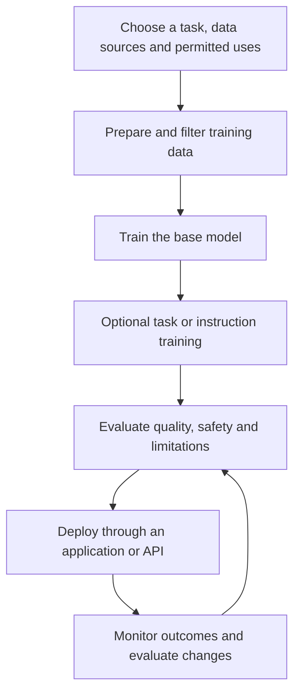
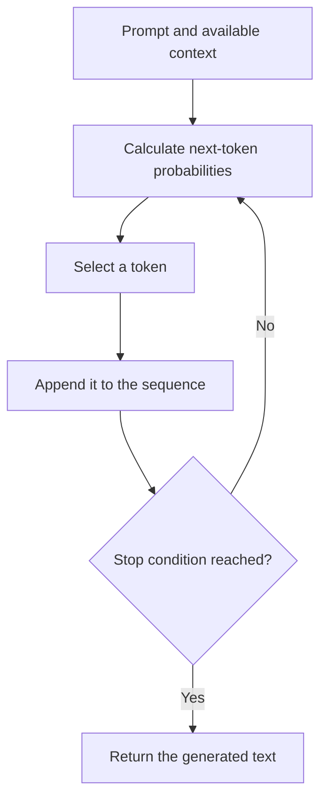
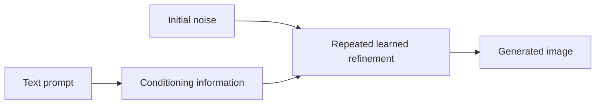
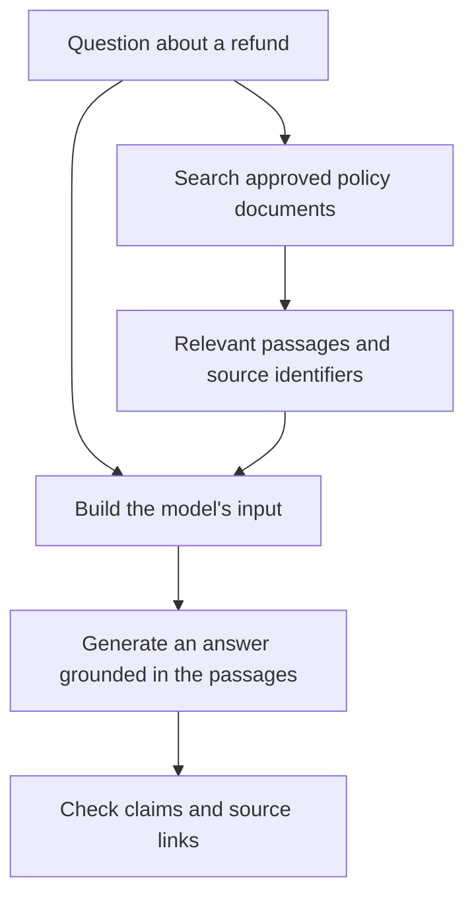

A spam filter decides whether an email belongs in the spam folder. A generative model can draft a reply to that email. Both can use machine learning, but they produce different kinds of results.

*Generative AI* refers to systems that use learned patterns to produce content such as text, code, images, audio or video. The model learns something about how data is structured, then uses that learned structure to generate an output.[^generative]

That output can be useful without being correct. It can also resemble training material. "Generated" does not guarantee original, factual or safe to use.

## What does "generative" mean?

Think about photographs of cats. A classifier might learn enough to distinguish a cat from a dog. An image generator has a different task: produce an image that fits patterns associated with cats, perhaps conditioned on a request such as "a ginger cat asleep on a blue chair".

The classifier does not need to draw fur, lighting or a chair to make its decision. The generator needs a way to produce the image.

In statistical terms, a generative model learns a distribution over data, possibly conditioned on inputs. A discriminative classifier learns how inputs relate to labels. The mathematics varies by model family, but the distinction explains why generating a convincing image is different from labeling one.[^generative]

These are not mutually exclusive applications. A text generator can also classify an email by producing the word "spam". A generative model can help solve a prediction task. The label describes its modeling approach, not a rule that forbids other uses.

### AI, machine learning, LLMs and agents

These terms describe different things:

| Term | What it describes |
| --- | --- |
| Artificial intelligence | The broad field of building systems that perform tasks associated with intelligence. |
| Machine learning | Methods that learn patterns or behavior from data rather than relying only on explicit rules. |
| Deep learning | Machine learning with multilayer neural networks. Most prominent current generative systems use it. |
| Generative AI | Systems that use learned models to produce content. Generative modeling also predates today's deep networks. |
| Large language model | A large model trained on language-related data. Many current LLMs generate text and code. |
| AI agent | An application that selects and performs actions toward a goal, often using an LLM. |

A *multimodal* model handles more than one type of input or output, such as text and images. Check the actual capabilities: accepting an image does not mean a model can generate one.

A model that writes an explanation does not automatically inspect your repository or execute commands. An application has to provide those capabilities. [AI agents, skills and the protocols between them]() covers that application layer.

## How does a generative model come to exist?

Someone chooses a model architecture, prepares data and trains the model on an objective. Training changes numerical parameters so the model performs better at that objective.

The broad lifecycle looks like this:



Filtering can remove some duplicates, low-quality examples and sensitive information. It cannot certify that everything left is accurate or appropriate. Decide whether the data sources and licenses permit the intended use before training begins.

There is no single training recipe for every generative model. Two examples make that easier to see.

### Text: learn to predict the next token

Many text-generating LLMs learn by predicting the next *token*, which is a piece of text determined by a tokenizer. A token can be a word, part of a word or punctuation.

During training, a passage supplies both the context and the target. For example:

```text
Context: The capital of Kenya is
Target: Nairobi
```

The actual tokenizer may split "Nairobi" into several tokens. The model predicts a distribution, a loss function measures how its prediction compares with the training target, and an optimizer adjusts the parameters. This happens across many examples.

This is *self-supervised learning*: the text supplies the prediction targets. It does not mean the entire system develops without human choices or human-generated data.

At inference time, the application gives the trained model a prompt. The model calculates next-token probabilities, a decoding method selects a token, and the process repeats. Parameters normally remain fixed during this process. The GPT-3 paper is one documented example of an autoregressive language model used for many tasks through prompting.[^gpt3]

When decoding samples from those probabilities, the same prompt can produce different answers. Temperature changes how concentrated the sampling distribution is. That affects variation, not whether the answer is factual.[^decoding]



This explains both the flexibility and a major limitation. Training text contains code, explanations and factual statements, so the model can learn patterns useful for producing them. But the probability of a continuation is not the probability that its claims are true.

For more detail about tokenization, attention and hardware, see [Large language models]().

### Images: learn to remove noise

Diffusion is another approach. In a simplified image diffusion setup, training adds controlled noise to an image and teaches a model to reverse that corruption. Generation starts with noise and repeatedly refines it toward a sample.[^diffusion]

Text-conditioned systems also use a representation of the prompt to guide this process. Some systems work in a compressed representation rather than directly on full-resolution pixels. Diffusion is a family of techniques, not a claim that every image generator follows the same steps.



The text example generates a sequence of tokens. This image example refines a noisy representation. Both are generative, but they do not have the same architecture or inference procedure.

### What do instruction tuning and RLHF add?

A base language model trained to continue text is not necessarily good at answering a user's request. Further training can change that behavior.

*Supervised instruction tuning* uses examples of requests and desired responses. *Preference training* uses judgments about which outputs are better. Reinforcement learning from human feedback, or RLHF, is one approach; the InstructGPT paper describes a pipeline with demonstrations, preference judgments and reinforcement learning.[^instructgpt]

Post-training can improve behavior, but it does not guarantee truthfulness. Nor does every model use RLHF. "Instruction-tuned" describes a training outcome or method, not proof that a model will reliably obey every instruction.

A *foundation model* is broadly pretrained so it can be adapted to a range of tasks. The term describes that role, rather than one architecture. Not every generative model has that breadth.[^foundation]

## What is new about it?

Generative modeling did not begin with chatbots. Variational autoencoders were described in work first published in 2013, and generative adversarial networks followed in 2014.[^vae][^gan]

| Model family | Basic idea |
| --- | --- |
| Autoregressive models | Generate a sequence by predicting its next element from preceding elements. |
| Variational autoencoders | Learn a probabilistic latent representation and a decoder that can generate samples. |
| Generative adversarial networks | Train a generator against a discriminator that tries to distinguish generated samples from training examples. |
| Diffusion models | Learn to reverse a corruption process and use that learned process to generate samples. |

This table is a map of common approaches, not a complete taxonomy. Architectures and techniques can be combined.

Several developments made modern systems more broadly useful. The Transformer paper introduced an attention-based architecture with more parallelizable training than the recurrent models it compared against.[^attention] Later work such as GPT-3 demonstrated that a large pretrained model could perform varied tasks from instructions and examples in its input, without a separate parameter update for each task.[^gpt3]

Instruction tuning made those capabilities easier to access through conversation. More capable hardware, larger training runs and better serving software helped make the systems available through applications and APIs.

The practical change is that one model can support many tasks through the same language interface. A developer can ask it to summarize an incident, suggest tests or rewrite a function without building a separate specialized model for each request.

That flexibility is useful. It is also why a chatbot demo tells you less than you might expect about whether the same model will handle your production task reliably.

## What is the alternative?

The alternative depends on the job. "Use AI" is not a requirement unless the problem actually needs it.

| Job | A reasonable starting point |
| --- | --- |
| Calculate an invoice total | Ordinary code with explicit arithmetic and rounding rules. |
| Return an order's delivery status | A database query or API call. |
| Classify thousands of messages into known categories | A classifier, with comparison against an LLM baseline if useful. |
| Find an exact clause in a policy | Search and show the source passage. |
| Produce a standard notification | A template populated with verified fields. |
| Draft a custom explanation from several documents | A generative model with relevant source material and review. |

Traditional software can generate text too. A receipt template produces text, but that does not make it generative AI. The distinction is the learned model, not the mere existence of an output.

Generative AI is a reasonable choice when you need flexible language or content generation and can check the result. It is a poor replacement for an authoritative database or a calculation you already know how to implement.

Often the best application combines both. Fetch the actual order status using code, then let a model help explain it. Do not ask the model to invent the status.

## Prompting, retrieval and fine-tuning solve different problems

These terms get mixed together, even though they change different parts of the system.

| Technique | What changes? | Example |
| --- | --- | --- |
| Prompting | The instructions and context provided for a request. | Ask for a short explanation and supply a sample of the desired format. |
| Retrieval-augmented generation, or RAG | The application retrieves external material and supplies it to the generator. | Retrieve the current refund policy before answering a customer. |
| Fine-tuning | Further training updates model parameters or trained adapters. | Train for a recurring task or response behavior using curated examples. |

RAG combines retrieval with generation. The original RAG paper describes a system that combines a pretrained generator with a retrieval component.[^rag] In a common application, the flow is:



Retrieving a document during a request does not, by itself, retrain the generator. A conversation stored by an application is not automatically a change to model weights either.

Many retrieval systems use *embeddings*, numerical representations that help compare passages by similarity. RAG does not require a vector database, though. Keyword search can retrieve useful context too.

For frequently changing information, retrieval is usually a better first step than trying to bake every new fact into weights. Fine-tuning may help with repeated behavior or a specialized task. Neither technique removes the need to evaluate the result.

## What should I watch out for?

NIST's *Generative Artificial Intelligence Profile* covers risks including confabulation, privacy, harmful bias, information integrity and intellectual property. Choosing a model is only part of managing them.[^nist]

### Fluent errors

A model can invent an API, a citation or a reason a test failed. People commonly call this a *hallucination*. Confident wording does not make the answer more reliable.

Check factual claims against sources. Run generated code and meaningful tests. For generated images, inspect details and suitability for the intended use.

Lowering temperature changes generation behavior; it does not switch on a truth mode. Structured output can make a response easier to parse, but valid JSON can still contain a wrong answer.

Performance also varies with the people, languages and situations represented in training and evaluation. A support assistant that handles English examples well may still fail on the languages your customers actually use. Test those cases and check for harmful stereotypes rather than relying on an aggregate score.

### Privacy, retention and rights

Before sending documents to a service, check what the provider stores, how long it keeps the data and whether the applicable product terms allow training on it. Do not assume every product from the same provider has the same policy.

Local inference can keep model inputs on your machine, but the surrounding application may still use remote services or telemetry. Check the whole data path.

Keep track of licenses and source provenance when using data or generated material. A model's ability to produce something does not establish your right to publish it. Requirements also depend on jurisdiction and use.

### Untrusted input and real actions

An instruction hidden in a retrieved document can try to redirect an assistant. This is *prompt injection*. It becomes especially dangerous when the application can send messages, access private information or modify systems.

Treat external material as data, enforce permissions in software and require review for consequential actions. Telling a model to "be careful" is not an access-control mechanism.

### Cost, latency and deployment choices

A hosted API reduces the hardware and serving work you manage. Running a model yourself gives you control over more of the stack, but you inherit the operational costs.

Compare the cost of the whole task, including retrieval, long inputs, retries, tool calls and human review. A cheap request that needs several corrections may cost more than a more reliable approach.

*Open weights* means that model parameters are available under a particular license. It does not necessarily mean the training data, complete training process or unrestricted commercial rights are available. Read the license and model documentation.

## How do I know whether it works for my task?

Build a small set of representative examples before choosing a model. Include ordinary requests, ambiguous inputs and cases where the system should decline or ask for help.

For a customer-support assistant, check whether it applies the right policy and cites the passage that supports the answer. Measure unsupported claims as well as successful answers. For code, test behavior rather than whether the explanation sounds convincing.

Compare against a simpler baseline. A search result with a useful excerpt may beat a generated paragraph. Record quality, latency, cost and the consequences of mistakes, then repeat the evaluation when you change the model, prompt or data source.

You do not need to train a foundation model to try this. Start with an existing model, a narrow task and information you are allowed to use. If ordinary code already solves the task clearly, keep it.

## References

[^generative]: Google Machine Learning, [What is a generative model?](https://developers.google.com/machine-learning/gan/generative). Explains generative and discriminative modeling and why the distinction is about learned distributions.
[^gpt3]: Brown et al. (2020), [Language Models are Few-Shot Learners](https://arxiv.org/abs/2005.14165). Documents autoregressive GPT-3 and task examples supplied without parameter updates at inference time.
[^decoding]: Hugging Face Transformers, [Generation strategies](https://huggingface.co/docs/transformers/main/en/generation_strategies). Explains next-token selection, greedy decoding and sampling.
[^diffusion]: Ho, Jain and Abbeel (2020), [Denoising Diffusion Probabilistic Models](https://arxiv.org/abs/2006.11239). A foundational paper on learning and sampling with image diffusion models.
[^instructgpt]: Ouyang et al. (2022), [Training language models to follow instructions with human feedback](https://arxiv.org/abs/2203.02155). Describes the InstructGPT post-training process and remaining limitations.
[^foundation]: Bommasani et al. (2021), [On the Opportunities and Risks of Foundation Models](https://arxiv.org/abs/2108.07258). Defines broadly trained models adaptable to many downstream tasks.
[^vae]: Kingma and Welling (first submitted 2013), [Auto-Encoding Variational Bayes](https://arxiv.org/abs/1312.6114). Introduces the variational autoencoder approach.
[^gan]: Goodfellow et al. (2014), [Generative Adversarial Networks](https://arxiv.org/abs/1406.2661). Introduces adversarial training of a generator and discriminator.
[^attention]: Vaswani et al. (2017), [Attention Is All You Need](https://arxiv.org/abs/1706.03762). Introduces the Transformer architecture.
[^rag]: Lewis et al. (2020), [Retrieval-Augmented Generation for Knowledge-Intensive NLP Tasks](https://arxiv.org/abs/2005.11401). Describes generation supported by an external retrieval component.
[^nist]: NIST (2024), [Artificial Intelligence Risk Management Framework: Generative Artificial Intelligence Profile](https://www.nist.gov/publications/artificial-intelligence-risk-management-framework-generative-artificial-intelligence). A cross-sector guide to generative AI risks and risk-management actions.
