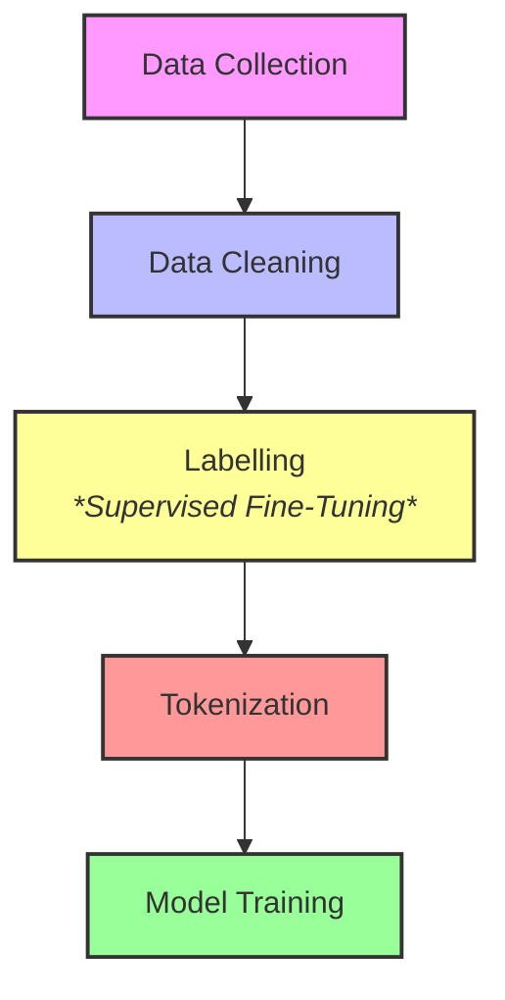

# Large Language Models

**Large Language Models (LLMs)** are artificial intelligence systems trained on massive amounts of text to understand, summarize, translate and generate human-like language.

## How do they work?

LLMs

## Components of LLMs

### Transformers

What are transformers

### Embedding

What are they?

## Training LLMs

Training LLMs is a massive undertaking requiring lots of data, complex algorithms and hardware. The pipeline can be vusualized as:
1. Data collection
2. Data cleaning
3. Labelling (if applicable)
4. Tokenization

### 1. Data Collection

This begins with massive data from various sources - books, articles, websites, code etc.

### 2. Data cleaning

Cleaning of the data is done by data scientists to remove errors, duplication and undesirable content.

### 3. Labelling

The data is then paired with the desired outputs, target classifications or human preferences

### 4. Tokenization

Text is then broken down into `tokens` in a process called **tokenization**.

### Training techniques

#### Pre-training

#### Fine-tuning

## Types of LLMs and Examples

### Zero-shot LLMs

### Fine-tuned LLMs

### Domain-specific LLMs

## Uses of LLMs

What are LLMs?
What types of LLMs exist? What differentiates them?
What are features, parameters in a model?
What is model training? What is fine tuning? What is the difference?
What does it mean a model "predicts"
Why is hardware important for running models? Why are GPUs expensive? What are the alternatives - TPUs?
Why is running models locally challenging? Mobile models?
What software is deisgned to interface with models?
Why are some models called "frontier models"? What does it mean?

