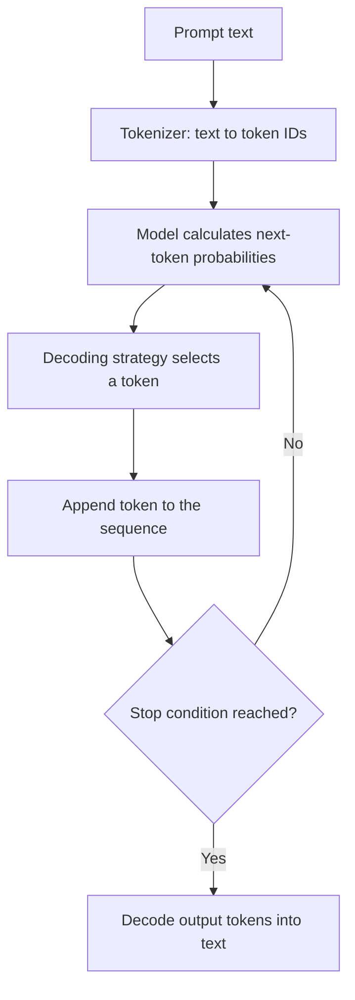
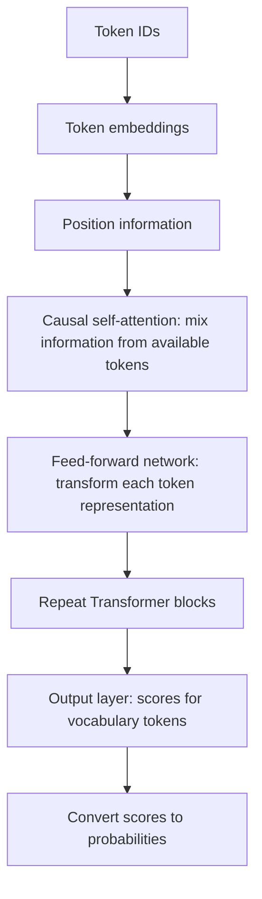
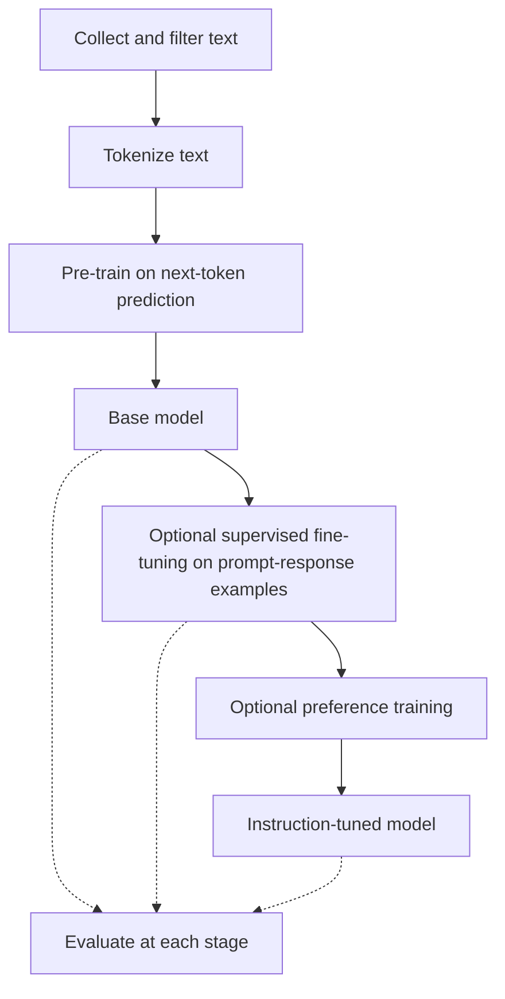
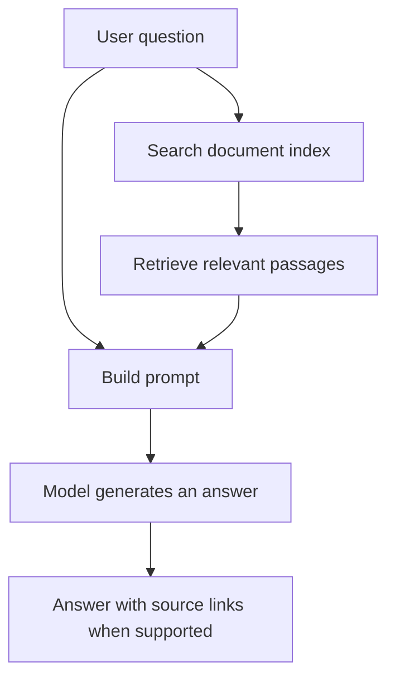
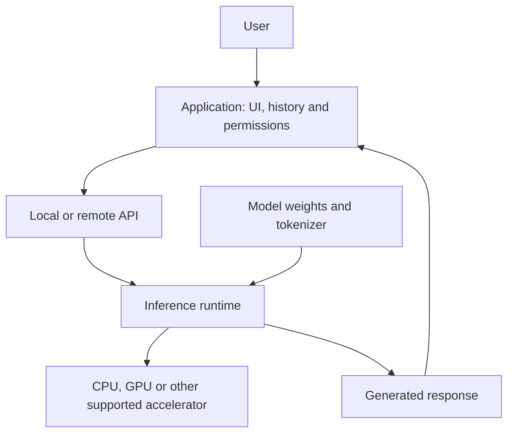

# Large language models

A large language model (LLM) is a neural network trained on large amounts of text to learn patterns in language. Those patterns let it generate text, answer questions, translate, write code and summarize documents. Some models also work with images or audio.

The word *model* means a mathematical system with learned numerical values, called *parameters*. Given an input, the system uses those values to calculate an output. "Large" usually refers to the number of parameters and the scale of training; there is no universal size at which a language model becomes an LLM.

It helps to separate the model from the application around it. A chat application can add conversation history, search, file access and tools. The model alone does not automatically have those abilities.

## What does it mean to predict text?

For a typical text-generating LLM, prediction means calculating which token could come next, given the tokens already available. A *token* is a piece of text: a word, part of a word, punctuation or even a space. The tokenizer determines the exact split.

Suppose the input is:

> The capital of Kenya is

The model assigns probabilities to possible next tokens. "Nairobi" should be a likely continuation. The application selects a token using a decoding strategy, adds it to the input and repeats the process until it reaches a stopping condition.[^generation]



This is *inference*: using a trained model. Its parameters normally stay fixed while it generates a response.

Choosing the highest-probability token is one decoding strategy. Sampling is another: it allows different continuations according to their probabilities. A setting called *temperature* adjusts how concentrated that distribution is. Lower temperatures generally make sampling more predictable; higher ones allow more variation. Neither setting guarantees a correct answer.

Predicting text can produce much more than sentence completion. Training examples contain explanations, programs and worked problems, so the model can learn patterns that support those tasks. But a plausible continuation can still be false. An invented citation or a confident factual error is often called a *hallucination*. A token's probability is not the probability that a claim is true.

## What is inside a model?

Most widely used LLMs are based on the *Transformer*, an architecture introduced in the 2017 paper *Attention Is All You Need*.[^attention] The following is a simplified view of a decoder-only Transformer, the kind commonly used for text generation.



The diagram leaves out details such as normalization and residual connections so the main path is easier to follow.

### Tokens and embeddings

The tokenizer converts text into numerical IDs. An *embedding* maps each ID to a vector, which is an ordered list of numbers the network can work with. Position information helps the model distinguish sequences such as "the dog chased the cat" and "the cat chased the dog".

The initial embedding for a token comes from learned parameters. As the token passes through the model, its representation changes with context. The word "bank" in "river bank" should have a different contextual representation from "bank account".

You may also encounter *embedding models* used for search. These produce vectors for whole passages so an application can compare their similarity. They serve a different purpose from a chat model that generates a reply.

### Attention and Transformer blocks

*Self-attention* lets a token's representation incorporate information from other tokens. In a decoder-only model, causal attention prevents a position from looking ahead at future tokens. For "The keys on the table are missing", attention can help connect "keys" with "are" despite the words between them.

Each block also has a feed-forward network that transforms the representations. Repeating these blocks lets the model build more complex representations of the sequence.[^transformers]

The *context window* is the limit on how many tokens the model can work with in one request. For typical chat models, instructions, conversation history, retrieved documents and generated output all compete for that budget. A large window does not guarantee that the model will use every detail reliably.

### Parameters, features and settings

These terms describe different things:

| Term | What it means |
| --- | --- |
| Parameters | Values learned during training, including weights in attention, feed-forward and embedding layers. A dense "7B" model has roughly seven billion parameters. |
| Features | Properties represented in the data or inside the network, such as patterns related to syntax or topic. They are often distributed across many activations rather than stored in one named location. |
| Hyperparameters | Choices made about training or architecture, such as learning rate or number of layers. |
| Generation settings | Controls used at inference time, such as temperature and output length. Changing these does not retrain the model. |

More parameters can increase capacity, but size alone does not tell you which model will perform best. Training data, architecture and the task also matter.

## How does a model learn?

Training changes parameters so the model performs better on an objective. In next-token pre-training, the training text supplies both the input and the correct continuation.

For example, training can use "The capital of Kenya is" as context and the token or tokens for "Nairobi" as targets. The model's prediction is compared with the actual next token using a *loss function*. Backpropagation calculates how parameters contributed to the error, and an optimizer adjusts them to reduce the loss. This repeats over many batches of text.

The model can learn a prediction at many positions in a sequence during one training pass. Generating new text is different: in the basic inference loop, each new token depends on the tokens selected before it.

### Pre-training and fine-tuning

*Pre-training* builds the initial model from a broad collection of text, often including code. Data preparation can include deduplication, quality filtering and removal of sensitive material. It cannot guarantee that all errors, bias or private information disappear.

Ordinary next-token pre-training is *self-supervised*: the targets come from the text itself. People do not need to label every sentence. Explicit demonstrations and preference labels usually enter later, during *post-training*.[^transformers]



This is a common route, not a required recipe for every model.

*Fine-tuning* is further training of an existing model for a task or behavior. Supervised fine-tuning might use examples of questions paired with useful answers. Preference training uses judgments about which responses are better. Reinforcement learning from human feedback (RLHF) is one approach; the InstructGPT paper documents a pipeline using demonstrations followed by preference-based training.[^instructgpt]

Fine-tuning is therefore a form of training, not a separate alternative to it. It starts with learned parameters rather than starting from scratch. Some techniques update the whole model; others train a smaller set of additional parameters, often called adapters.

### Prompting and retrieval are different

A prompt changes what the model sees, not its learned parameters. Giving it examples in the prompt is *few-shot prompting*. Asking without examples is *zero-shot prompting*. These describe how you use a model, not separate model architectures.

Retrieval-augmented generation (RAG) supplies relevant material from an external source, such as a document index, before the model answers.[^rag] For example, a support application could retrieve the current refund policy and include it with a customer's question.



Retrieval at inference time does not itself retrain the generator. It can provide current facts and source material, but the model can still misread a passage or cite something that does not support its claim.

If you need an answer based on today's policy, retrieval is usually a better starting point than fine-tuning. If you need consistent output formatting or task behavior, fine-tuning may help.

## What kinds of models exist?

There are several ways to describe a model, and the labels overlap.

### Architecture

| Architecture | How it works | Examples and common uses |
| --- | --- | --- |
| Encoder-only | Builds representations using context on both sides of a token. | BERT; classification, extraction and search representations. |
| Decoder-only | Uses preceding tokens to predict the next token. | GPT and Llama families; chat, code and text generation. |
| Encoder-decoder | Encodes an input, then generates an output conditioned on it. | T5; translation and summarization. |

BERT is a useful architectural comparison, though people often mean generative decoder-only models when they say "LLM" today.[^transformers]

Another distinction is *dense* versus *mixture-of-experts* (MoE). A dense model uses the same parameter blocks for each token. An MoE model routes tokens through selected expert networks. Its total parameter count can be much larger than the number active for each token, so total size and computation per token are different measurements.

### Training, inputs and access

A *base model* has undergone pre-training. An *instruction-tuned model* has further training to respond to instructions. A *domain-specific model* has training focused on an area such as medicine or code. One model can be both instruction-tuned and domain-specific.

A *multimodal model* accepts or produces more than text, for example images or audio. A text-only model cannot inspect a photograph just because a chat interface allows an attachment.

With *open-weight models*, you can obtain the learned parameters and run them yourself, subject to the license. That does not necessarily mean the training data or full training process is available. Hosted proprietary models are generally accessed through an application or API instead. Always check the particular model's license and model card rather than assuming "open" means unrestricted.

### What does "frontier" mean?

A *frontier model* is generally one near the leading edge of capability at a given time. It is not a particular architecture or parameter count, and the label moves as models improve. Policy definitions can be narrower: the paper *Frontier AI Regulation* focuses on highly capable foundation models that could pose severe risks to public safety.[^frontier]

For choosing a model, a result on your own task is more useful than the label. A smaller specialist may be sufficient for extracting fields from invoices even if a frontier model performs better on broad benchmarks.

## Why does hardware matter?

Running a model means doing large amounts of numerical computation and moving its parameters through memory. Training adds the work of calculating gradients and updating parameters, plus memory for training state.

GPUs perform many operations in parallel and have memory systems suited to these workloads. They were developed for graphics, but the same ability to process large arrays of numbers is useful for neural networks.

High-end AI GPUs are expensive partly because they combine complex chips with large amounts of fast memory and high-speed connections. A training cluster also needs networking, power and cooling. Price depends on supply and demand as well as hardware capability; it is not simply a price per parameter.

GPUs are not mandatory for all inference. CPUs can run smaller models, often at lower speed. Google's *Tensor Processing Units* (TPUs) are specialized accelerators for machine-learning workloads, especially large matrix operations.[^tpu] Phones and laptops may also have neural processing units (NPUs), but the runtime must support the hardware and model.

### Will a model fit on my computer?

A useful first estimate is:

```text
weight memory = parameter count x bits per parameter / 8
```

For a dense 7B model, that gives:

| Weight precision | Approximate weight memory |
| --- | --- |
| 32-bit | 28 GB |
| 16-bit | 14 GB |
| 8-bit | 7 GB |
| 4-bit | 3.5 GB |

These are decimal gigabytes for the weights alone, not total system requirements. You also need memory for intermediate calculations, runtime overhead and, in typical Transformer generation, a *KV cache*. This cache stores attention keys and values from processed tokens so the runtime can reuse them. Longer contexts and more simultaneous requests increase its memory use.

*Quantization* stores weights, and sometimes other values, with fewer bits. It can reduce memory requirements substantially, but quality and speed depend on the method and hardware.[^quantization] A 4-bit 7B model therefore needs more than 3.5 GB of usable memory to run.

Local inference also depends on memory bandwidth, supported operations and how quickly you need an answer. Having enough disk space to download a model does not mean you have enough RAM or GPU memory to run it comfortably.

### What about phones?

Phones can run smaller models, often with quantization and runtimes designed for the device. Some small models are trained through *distillation*, where a larger model helps teach a smaller one.

The constraints include shared memory, battery use and heat. A model that runs for a short demonstration may slow down under sustained use. On-device inference can work offline and keep inputs on the device, provided the application does not send them elsewhere. Google's LiteRT-LM is one runtime for deploying models on mobile and other devices.[^mobile]

## What software connects an application to a model?

The model weights are only part of a working system. A *runtime* loads them and executes the computation. A server can expose that runtime through an API, which an application calls.



For local use, [Ollama](https://docs.ollama.com/) manages model downloads and provides an API. [llama.cpp](https://github.com/ggml-org/llama.cpp) runs supported models on CPUs and several GPU backends, including mixed CPU/GPU execution.

For development, [Hugging Face Transformers](https://huggingface.co/docs/transformers/) provides model-loading, training and inference APIs. For serving concurrent requests, [vLLM](https://docs.vllm.ai/en/stable/) provides an inference server with batching and memory-management optimizations. Hosted model APIs move the hardware and serving work to a provider, in exchange for usage charges and the provider's data-handling terms.

These tools are not interchangeable with the models they run. Check the runtime's support for the model architecture, file format, quantization method and hardware.

## Using models well

LLMs are useful for drafting, summarizing and translating text, extracting structured information and helping with code. The amount of checking depends on the consequences of an error. A draft email and a medical recommendation should not have the same review process.

For a concrete task, compare candidate models on representative examples. Check correctness, latency, memory use, cost and data-handling requirements. For code, run tests. For factual answers, open the cited sources and check that they support the claims. A polished answer is still an answer you may need to verify.

## References

The numbered notes link claims to source papers and documentation. The Transformer paper explains the architecture; the Hugging Face course is a more approachable starting point. Runtime links above lead to their own documentation.

[^generation]: Hugging Face, [Text generation](https://huggingface.co/docs/transformers/llm_tutorial). A practical guide to token generation and decoding settings.
[^attention]: Vaswani et al. (2017), [Attention Is All You Need](https://arxiv.org/abs/1706.03762). The original Transformer paper.
[^transformers]: Hugging Face LLM Course, [How do Transformers work?](https://huggingface.co/learn/llm-course/chapter1/4). Covers architecture families, self-supervised learning, pre-training and fine-tuning.
[^instructgpt]: Ouyang et al. (2022), [Training language models to follow instructions with human feedback](https://arxiv.org/abs/2203.02155). Documents supervised fine-tuning and RLHF for InstructGPT.
[^rag]: Lewis et al. (2020), [Retrieval-Augmented Generation for Knowledge-Intensive NLP Tasks](https://arxiv.org/abs/2005.11401). A foundational paper combining retrieval with generation.
[^frontier]: Anderljung et al. (2023), [Frontier AI Regulation: Managing Emerging Risks to Public Safety](https://arxiv.org/abs/2307.03718). A risk-focused definition of frontier AI.
[^tpu]: Google Cloud, [Introduction to Cloud TPU](https://cloud.google.com/tpu/docs/intro-to-tpu). Explains TPUs and workload considerations for CPUs, GPUs and TPUs.
[^quantization]: Hugging Face Transformers, [Quantization overview](https://huggingface.co/docs/transformers/quantization/overview). Describes reduced-precision storage and supported methods.
[^mobile]: Google AI Edge, [LiteRT-LM overview](https://developers.google.com/edge/litert-lm/overview). Documents a runtime for on-device language models and supported accelerators.
