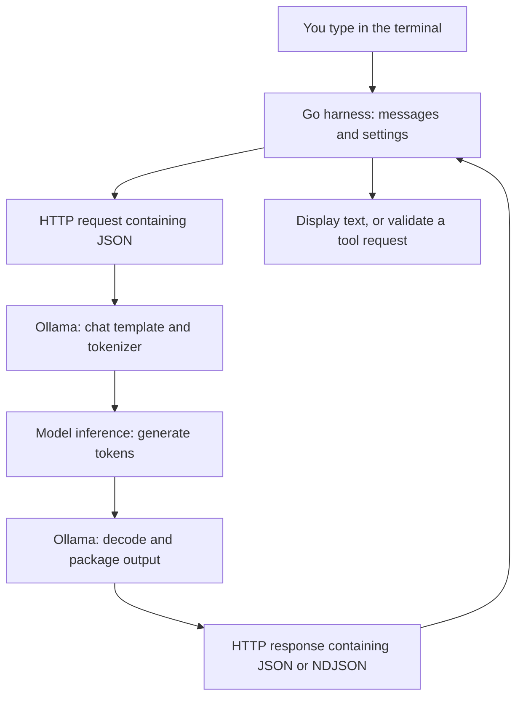
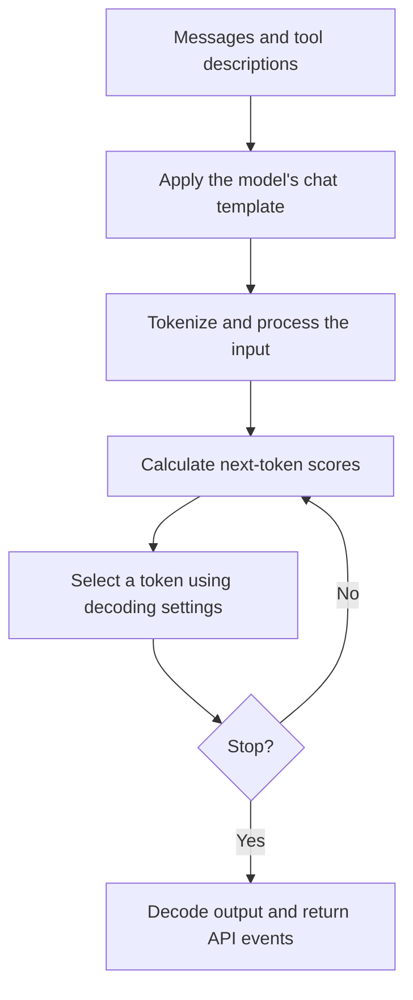
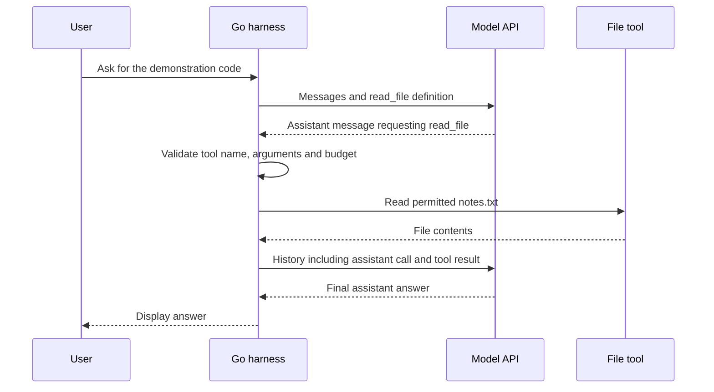

When I type a question into a coding assistant, what reaches the model? Is it my sentence, a JSON document, the whole conversation, or something else? And when people mention JSONL, are they talking about prompts, training data or streamed answers?

I want to separate those things by building something small enough to read. We will run a local model, call it over HTTP from Go, keep a conversation and let it request one read-only tool. The program will also write a trace so we can inspect what it sends.

The [complete example](https://github.com/musale/musale-dev/tree/master/static/examples/go-harness) uses only Go's standard library. The snippets in this article are excerpts, not separate programs. You can also download [main.go](/examples/go-harness/main.go), [go.mod](/examples/go-harness/go.mod), [the tests](/examples/go-harness/main_test.go) and [the sample note](/examples/go-harness/workspace/notes.txt).

I exercised the example with Go 1.26.2, Ollama 0.32.14 and `qwen3:0.6b` on an Intel Mac with 16 GiB of RAM. This is a demonstration of the plumbing, not a model benchmark. Some of its answers are less obedient than the prompts ask for.

## What are we actually running?

The model and the application around it do different jobs.

| Piece                       | Its job in this example                                                      |
| --------------------------- | ---------------------------------------------------------------------------- |
| Model weights               | Learned numerical values used to predict the next token.                     |
| Tokenizer and chat template | Convert messages into the token sequence the model expects.                  |
| Ollama                      | Load the model, run inference and expose an HTTP API.                        |
| Go program                  | Build requests, keep history, handle responses and enforce tool permissions. |
| Terminal                    | Collect what we type and display the answer.                                 |

The Go program is the beginning of a _harness_: the application code around a model that manages its interaction with a task and its environment.



This explains a common source of confusion: we send JSON to an API, but the neural network does not execute that HTTP request. The runtime converts the relevant messages and tool descriptions into model-specific input. Generation continues a sequence of tokens.[^templates]

## Start a small model locally

Install [Ollama](https://ollama.com/download) and [Go](https://go.dev/dl/). The example requires Go 1.24 or later because its file tool uses `os.OpenRoot`.

In one terminal, start a local-only server:

```sh
OLLAMA_HOST=127.0.0.1:11434 OLLAMA_NO_CLOUD=1 ollama serve
```

Leave that terminal running. If the Ollama desktop app or a service already owns the port, quit it first, or configure and restart that service instead. Setting variables in a new shell does not reconfigure a server that is already running.

In another terminal:

```sh
curl --fail --silent --show-error http://127.0.0.1:11434/api/version
ollama pull qwen3:0.6b
ollama list
```

The downloaded artifact on my test installation was about 523 MB, with `Q4_K_M` quantization. Quantization stores weights with reduced numerical precision to reduce their size. The download size is not the total RAM requirement: runtime buffers and the context cache need memory too.

Qwen3 supports thinking and non-thinking modes. We will explicitly send `"think": false` to keep this exercise focused on the answer and tool calls.[^qwen][^thinking] That setting is model-dependent; it is not a universal field understood by every model API.

`OLLAMA_NO_CLOUD=1` disables Ollama's cloud features. Pulling the model still needs a download, but inference with this local model does not require sending the prompt to a hosted model. Keep the listener on loopback; do not expose this service publicly as though it had application authentication.[^faq]

## Inspect one request before writing Go

Run this in the second terminal:

```sh
curl --fail-with-body --silent --show-error --max-time 120 \
  http://127.0.0.1:11434/api/chat \
  -H 'Content-Type: application/json' \
  -d '{
    "model": "qwen3:0.6b",
    "messages": [
      {"role": "system", "content": "You are a concise assistant."},
      {"role": "user", "content": "Reply with just the word Nairobi."}
    ],
    "stream": false,
    "think": false,
    "options": {
      "temperature": 0.2,
      "num_ctx": 4096,
      "num_predict": 256
    }
  }'
```

This is an ordinary HTTP POST. There is no agent framework involved. Ollama's native chat endpoint accepts a model name and a list of messages.[^chat]

The response in my run included:

```json
{
  "model": "qwen3:0.6b",
  "created_at": "2026-11-10T06:16:18.852259Z",
  "message": { "role": "assistant", "content": "Nairobi." },
  "done": true,
  "done_reason": "stop",
  "total_duration": 3380230238,
  "load_duration": 3152542642,
  "prompt_eval_count": 34,
  "prompt_eval_duration": 151846000,
  "eval_count": 4,
  "eval_duration": 61967000
}
```

The model metadata and timing fields are token counts that describe this run, not a fixed cost for the word "Nairobi".

Notice the two layers: the JSON object is the API's response envelope. `"Nairobi."` is the model's answer inside it. If you ask the model to return JSON, that generated JSON can itself appear as a string in `message.content`. Parsing the outer response does not validate the contents of that string.

### What do the roles mean?

`system` supplies application-level guidance. `user` contains the user's input. `assistant` contains a previous model response. We will add `tool` later for a result produced by application code.

These are conventions the model learned through its training and message format. A system message saying "never read private files" does not remove filesystem permissions from the Go process. The application must enforce that restriction.

The JSON wrapper also contains settings which are not prose instructions:

| Setting            | Meaning here                                                                                                   |
| ------------------ | -------------------------------------------------------------------------------------------------------------- |
| `stream: false`    | Return one JSON response instead of incremental events. Ollama streams by default.                             |
| `think: false`     | Request Qwen3's non-thinking mode. The example does not collect thinking output.                               |
| `temperature: 0.2` | Use a relatively concentrated sampling distribution. This does not guarantee correctness or identical replies. |
| `num_ctx: 4096`    | Request a context window of 4,096 tokens for this runtime.                                                     |
| `num_predict: 256` | Limit the number of generated tokens. An answer can hit this limit before it is complete.                      |

The temperature is a choice for this short demonstration, not a claim about Qwen3's best settings. Its model card provides recommendations for different modes.[^qwen]

### What happens after the server receives it?

The chat template arranges the messages using the format the model expects. The tokenizer turns the resulting input into token IDs. Different models use different role markers, so we let the runtime handle that rather than inventing a universal prompt format.[^templates]

The runtime processes the input, often called _prefill_, then generates output by repeatedly selecting another token. It stops at a model stop condition, an output limit or an interruption.



That is why an answer arrives gradually. The model normally does not produce a finished paragraph and then reveal it one character at a time. If you want more detail about tokens and inference, [the LLM article]() covers the underlying model.

## What is JSONL?

JSON Lines, usually saved as `.jsonl`, is UTF-8 text with one valid JSON value per line. Each value is often an object, but it does not have to be. A blank line is not a valid record. A final newline is recommended.[^jsonlines]

This is a JSONL file containing two chat examples:

```jsonl
{"messages":[{"role":"user","content":"Say hello."},{"role":"assistant","content":"Hello."}]}
{"messages":[{"role":"user","content":"What is 2 + 2?"},{"role":"assistant","content":"4."}]}
```

It is not a JSON array, and there are no commas between the lines. A consumer reads and parses each record separately.

That example could be a dataset format, but the consumer decides the schema. Another training pipeline might require a `text` field instead of `messages`. Renaming a file to `.jsonl` does not make it compatible with every trainer.

JSONL describes how records are separated. It does not mean "training", "prompting" or "agent" by itself. We can use the same format for application logs, batch inputs or events. None of the chat requests in this tutorial train or fine-tune the model.

### JSONL, NDJSON and streaming

Ollama calls its streaming format newline-delimited JSON, or NDJSON, and serves it as `application/x-ndjson`.[^streaming] For these object-per-line examples, it has the same practical structure as JSONL.

Changing the request to `"stream": true` gives events shaped like this:

```jsonl
{"message":{"role":"assistant","content":"Hel"},"done":false}
{"message":{"role":"assistant","content":"lo"},"done":false}
{"message":{"role":"assistant","content":""},"done":true,"done_reason":"stop"}
```

This is an illustrative, shortened stream. The displayed answer is the concatenation of the content chunks: `Hello`.

One line is an event, not necessarily one token. A text newline inside a content string appears as the JSON escape `\n`, so it does not split that record into two physical lines. Network reads are another boundary entirely: one read can contain several events or only part of one.

Do not assume every streaming API uses NDJSON:

| Format                   | How to recognise it                                                                                                  |
| ------------------------ | -------------------------------------------------------------------------------------------------------------------- |
| One JSON response        | A single response document, as with `stream: false` here.                                                            |
| JSONL / NDJSON           | Consecutive JSON values, one per line.                                                                               |
| Server-sent events (SSE) | `text/event-stream`, with fields such as `data:` and blank lines separating events. A data payload may contain JSON. |

An SSE parser must handle the SSE framing before parsing JSON inside a data field. Feeding the raw `data:` lines to a JSON decoder will not work.[^sse]

Also check which Ollama endpoint you are using. `/api/chat` places text in `message.content`; `/api/generate` uses `response`. Examples for those endpoints are not interchangeable.[^chat][^streaming]

## Query the model from Go

Get the complete example:

```sh
git clone --depth 1 https://github.com/musale/musale-dev.git
cd musale-dev/static/examples/go-harness
go test ./...
go run . -prompt 'Explain what a token is in one sentence.'
```

You do not need an API key or an Ollama Go SDK. The server must still be running, and the model must have been pulled.

The request built by the program has the same structure as the curl request:

```go
request := ChatRequest{
    Model: model, Messages: history, Stream: stream, Think: false,
    Options: Options{Temperature: 0.2, NumCtx: 4096, NumPredict: 256},
}
```

`ChatRequest` is a Go struct whose JSON tags name the API fields. Here is the HTTP portion of `Client.complete`, with trace-writing omitted:

```go
body, err := json.Marshal(request)
if err != nil {
    return Message{}, fmt.Errorf("encode request: %w", err)
}
req, err := http.NewRequestWithContext(
    ctx, http.MethodPost, c.URL, bytes.NewReader(body),
)
if err != nil {
    return Message{}, err
}
req.Header.Set("Content-Type", "application/json")
resp, err := c.HTTP.Do(req)
if err != nil {
    return Message{}, fmt.Errorf("call Ollama: %w", err)
}
defer resp.Body.Close()
```

`json.Marshal` serializes the request. `http.NewRequestWithContext` creates the POST, and `http.Client.Do` sends it. The model-specific work happens behind that HTTP endpoint, not inside the Go HTTP client.

One small detail matters: `Think` has the tag `json:"think"`, not `json:"think,omitempty"`. The latter would omit a false boolean, which could leave the server using its default instead of the mode we requested.

For responses, the program creates `json.NewDecoder(io.LimitReader(resp.Body, 1<<20))`. It repeatedly calls `decoder.Decode(&event)` into a `ChatResponse` and joins the `event.Message.Content` strings. With streaming enabled, it also prints each content chunk as it arrives. The same loop can read a single final object or a stream of objects; Go's decoder reads successive JSON values without assuming that each network read contains a whole event.

The decoder is not a strict JSONL validator. It can accept whitespace between values, including pretty-printed JSON. That is useful for reading this API, but different from enforcing one physical line per record in a dataset.

### Try streaming

```sh
go run . -stream \
  -prompt 'Complete this sentence in at most eight words: A token is'
```

On my run it answered:

```text
A token is a small item used to represent something more valuable.
```

The stream handling worked. The answer exceeded eight words and used the everyday meaning of "token" rather than the language-model meaning. I had not specified that context. A successful HTTP call is a poor test of whether the answer did the job.

### Do not treat every HTTP 200 as a complete answer

The example checks HTTP status codes before decoding a successful response. It also checks the `error` field in every event, because a stream can fail after its HTTP headers have already said `200 OK`.[^errors]

It requires a final `done: true`. An unexpected end of the body is an error, not permission to pretend the partial answer is complete. It also reports `done_reason: "length"` as an incomplete answer.

The client has timeouts and a response-body limit. Ctrl-C cancels the request. The point of these checks is to make failure visible; a little text printed to the terminal does not prove that the request finished.

## Prompting is deciding what context to send

"Explain tokens" leaves the model to choose the meaning, audience and level of detail. A more useful prompt is:

```text
Explain tokens in language models to a Go programmer.
Use one short example of text split into possible tokens.
Say that the exact split depends on the tokenizer.
Keep the answer under 120 words.
```

This names the subject and audience, provides a way to make the explanation concrete, and gives a length target. It still needs checking.

When the answer depends on private or current facts, supply those facts or provide a way to retrieve them. A model cannot know the contents of a local file just because the prompt names it. Likewise, "give citations" does not give it a browser.

For extraction, specify what to do when information is missing:

```text
Using only the note below, return the project name and release date.
If the note does not state a release date, use null.
Return a JSON object with fields "project" and "release_date".

<note>
The project is called Paper Kite.
Its release checklist requires review and approval.
</note>
```

The delimiters make the data easier to distinguish from the task. They are not a security boundary. The harness must still validate generated JSON and verify facts against the note. For stricter output syntax, Ollama also supports a `format` field containing a JSON schema; the example client does not implement that option.[^chat]

Avoid adding an entire repository to every question. Irrelevant context consumes space and can distract the model. Choosing what to include is part of the harness's job.

## Where does conversation memory live?

Run the program without `-prompt`:

```sh
go run .
```

A test conversation produced this output:

```text
you> Remember the code KITE-839. Reply OK.
OK.
you> What code did I tell you? Reply with only the code.
KITE-839
you> /quit
```

The Go program keeps `history` in memory. It starts with a system message, appends the user message, sends the history, then appends the assistant response. On the next turn it sends that growing list again.

The second request therefore contains both earlier messages:

```json
{
  "messages": [
    { "role": "system", "content": "...application instructions..." },
    { "role": "user", "content": "Remember the code KITE-839. Reply OK." },
    { "role": "assistant", "content": "OK." },
    {
      "role": "user",
      "content": "What code did I tell you? Reply with only the code."
    }
  ]
}
```

This is a shortened request excerpt, not a complete request body.

The model has not learned a new permanent fact by changing its weights. It has the code in its input. Restart this Go program and its history is gone.

The runtime may keep a _KV cache_ of intermediate attention calculations to reuse work. That cache is an inference optimization, not a durable conversation database. Our application still supplies the history it wants the model to use.[^cache]

The example refuses conversations beyond 32 messages or 8,000 bytes of message content and tool-call names and arguments. These are crude application limits, not token accounting. The 4,096-token context also includes template and tool overhead, so these checks do not prove every possible input fits. A fuller harness needs model-aware token budgeting and an explicit policy for selecting or summarizing history.

## Add a tool without giving the model a shell

The sample workspace contains:

```text
The project is called Paper Kite.
Its release checklist is: run the tests, review the diff, then ask for approval.
The demonstration code is BLUE-47.
```

Enable the tool and ask for information that is in that file:

```sh
go run . -tools -root workspace \
  -prompt 'Read notes.txt using read_file and tell me the demonstration code. Do not guess.'
```

The program supplies a tool definition named `read_file`, with an argument schema allowing only `"path": "notes.txt"`. It receives an assistant message with a request shaped like this:

```json
{
  "role": "assistant",
  "content": "",
  "tool_calls": [
    {
      "function": {
        "name": "read_file",
        "arguments": { "path": "notes.txt" }
      }
    }
  ]
}
```

That is data. The model has not opened the file.

The Go code checks the name and arguments, reads the allowed file, appends the assistant's tool-call message and a `tool` result, then makes another model request.[^tools] It handles every call in the returned array, rather than assuming there will always be one.

The new history includes a result like this:

```json
{
  "role": "tool",
  "tool_name": "read_file",
  "content": "The project is called Paper Kite.\nIts release checklist is: run the tests, review the diff, then ask for approval.\nThe demonstration code is BLUE-47.\n"
}
```



My run logged the actual call to stderr:

```text
tool: read_file {"path":"notes.txt"}
```

The final answer was:

```text
The project is called Paper Kite. Its release checklist is: run the tests, review the diff, then ask for approval. The demonstration code is BLUE-47.
```

It found the code, but repeated the rest of the note too. Tool use and precise answer formatting are separate things to evaluate.

### Put permissions in code

The tool schema helps the model form a request. The Go code still independently rejects unknown tools, extra arguments and every path except `notes.txt`. It opens the workspace with `os.OpenRoot`, which provides traversal-resistant file access on the tested platform.[^osroot]

The tool accepts only a regular UTF-8 file of at most 2,048 bytes. It rejects symlinks. A denied or failed call becomes an explicit error on stderr and a JSON error result sent back to the model. It does not substitute empty contents or claim that a read succeeded.

This is a toy workspace owned by the person running the program, not a sandbox for a hostile filesystem. Do not point it at sensitive material. `os.Root` constrains path resolution; it does not isolate the whole process, stop other processes changing files, or make secrets inside the root safe to disclose.

The loop allows at most four model requests and four tool calls per user turn. A two-minute context deadline limits that turn's model requests. It stops with an error when it exhausts a budget.

For simplicity, this example refuses to combine `-stream` and `-tools`. A fuller client can support both, but it must assemble streamed tool-call fragments correctly before executing anything.

There is no MCP server here. The harness calls a local Go function directly. MCP would be useful if we wanted a standard interface to tools supplied by other processes. It would not replace the harness's authorization checks. [The agents article]() explains that distinction.

## Record what the harness sends

Create a fresh private temporary directory and enable tracing:

```sh
trace_dir=$(mktemp -d)
go run . -tools -trace "$trace_dir/tools.jsonl" \
  -prompt 'Read notes.txt using read_file and tell me the demonstration code. Do not guess.'
nvim "$trace_dir/tools.jsonl"
```

Each request and each decoded response event becomes one JSONL record. A non-streaming tool interaction normally has four records: request, tool-call response, follow-up request and final response. A streamed answer has more response records.

The record wrapper is our own format, not a model API requirement:

```jsonl
{"kind":"request","request":{"model":"...","messages":[]}}
{"kind":"response","response":{"message":{"role":"assistant","content":"..."},"done":true}}
```

Those are abbreviated examples. The real trace includes the supplied messages and settings. It records the decoded response fields the client knows about, not a byte-for-byte capture of HTTP headers and every server field.

The program creates the trace file with mode `0600` on Unix and refuses to overwrite an existing file. Choose a new filename for another run. Traces can contain prompts, private conversation history and file contents, so do not publish them. In particular, keep them outside this blog's `static/` directory, which Hugo copies into the website.

To see whether a tool really ran, inspect the assistant call and the following request's tool result, rather than trusting a sentence such as "I checked the file." To investigate a lost conversation, inspect the messages in the next request.

## What have we built, and what is still missing?

We have a small harness that owns the prompt, conversation state, HTTP client, tool dispatch and limits. With tools enabled, it lets the model choose an action and then respond to its result. That is the bounded model-and-tool loop described in the agents article.

It is not a reproduction of Copilot's or Claude's private implementation. Larger coding assistants have additional work to do: choose repository context, persist sessions, handle edits, request approvals, isolate commands and recover from failures. Some also load skills or connect to MCP servers.

The useful next experiment is to make a small evaluation set before adding more tools. Check whether the model reads the note when it needs it, quotes the code correctly, admits a missing fact and handles a denied read. Keep tests for HTTP errors and interrupted streams separate from tests of answer quality.

A larger model may follow the wording better. It cannot replace the application's permission checks or decide whether your tests are adequate.

[^templates]: Hugging Face Transformers, [Chat templates](https://huggingface.co/docs/transformers/chat_templating), explains how role-based messages become model-specific token sequences.

[^qwen]: Qwen, [Qwen3-0.6B model card](https://huggingface.co/Qwen/Qwen3-0.6B), documents the model, supported modes and recommended generation settings.

[^thinking]: Ollama, [Thinking](https://docs.ollama.com/capabilities/thinking), documents model-dependent thinking controls and separate thinking and answer fields.

[^faq]: Ollama, [FAQ](https://docs.ollama.com/faq), covers local data processing, cloud disabling, listener configuration, context size and model residency.

[^chat]: Ollama, [Generate a chat message](https://docs.ollama.com/api/chat), specifies the native chat request, response, structured-output format and generation options.

[^jsonlines]: [JSON Lines](https://jsonlines.org/), format requirements and file conventions.

[^streaming]: Ollama, [Streaming](https://docs.ollama.com/api/streaming), documents NDJSON responses and how to disable streaming.

[^sse]: MDN, [Using server-sent events](https://developer.mozilla.org/en-US/docs/Web/API/Server-sent_events/Using_server-sent_events), describes event-stream framing, fields and message boundaries.

[^errors]: Ollama, [Errors](https://docs.ollama.com/api/errors), covers status codes and errors emitted after a stream has started.

[^cache]: Hugging Face Transformers, [Caching](https://huggingface.co/docs/transformers/cache_explanation), explains reuse of attention keys and values during generation.

[^tools]: Ollama, [Tool calling](https://docs.ollama.com/capabilities/tool-calling), shows tool definitions, assistant calls and follow-up messages containing tool results.

[^osroot]: Damien Neil, Go Blog, [Traversal-resistant file APIs](https://go.dev/blog/osroot), introduces `os.Root` in Go 1.24 and describes its protections and limitations.
